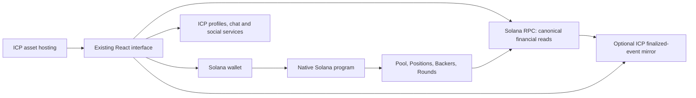

# Musical Chairs native Solana — discovery specification

> **Superseded 2026-10-13:** the [reconciled specification](2026-10-13-native-solana-reconciled-spec.md) consolidates this document with the accepted defaults, economics, availability and host-model contracts and resolves their status wording. This file is retained as evidence history; where they differ, the reconciled specification governs (its section 2 lists each reconciliation).
> Update 2026-10-13: Rob accepted the defaults and authorized the Rust economic model plus local provider/resource and compiled SBF runtime probes. [Acceptance and scope](../../solana/launch-decisions.md). Earlier discovery status/evidence paragraphs are historical; no deployment or live financial action is authorized.
Date: 2026-10-12. Status: **draft for discussion, not an approved execution specification**.
Source inspected initially on `main` at `f96b33ff95020458be754bfa0d7471b72a7403af`; documentation branch: `codex/native-solana-discovery-20261012`. Source files are unchanged on that branch.
Companion: [implementation roadmap](../plans/2026-10-12-native-solana.md), [economic/lifecycle recommendation](../../coordination/native-solana-economics.md), [discovery evidence](../../coordination/native-solana-discovery.md), [team board](../../coordination/kanban.md).

Current [processing/outage recovery](../../coordination/native-solana-availability.md) incorporates Rob's no-indefinite-stuck-round requirement. [Recommended defaults](../../coordination/native-solana-defaults.md) resolves the remaining policy choices for discussion. Rob authorized the Foundation refresh; [verified skill receipt](../../coordination/solana-skill-assessment.md) records v2.6.0 and preserved rollback/symlink.

[ICP placement and pilot budget](../../coordination/native-solana-icp-budget.md) models Rob's selected ~100 active Backers/1,000 payouts/10 closes monthly. ICP keepers are viable; at unmeasured eight-row batching, threshold signing is material, so hybrid primary/ICP-backup is recommended. Conditional startup envelope 12 SOL and monthly 0.5–1.5 SOL are planning allowances, with ICP cycles/subscriptions separate.

## 1. Product brief

Rob wants Musical Chairs' financial logic on Solana, with the frontend continuing to be hosted on ICP. The existing look, feel, navigation, terminology, and major screens should remain recognizable. Minor changes needed for wallet transactions and accurate chain status are in scope; a visual overhaul is not.

Success for the SOL game means a Solana wallet signs program instructions, the Solana program controls the pooled SOL and financial state, and a user can verify a deposit, payout, or Backer claim from Solana accounts and transaction receipts. ICP must not be the authority that decides or signs ordinary native SOL payouts.

This document recommends a target architecture and records the decisions needed to freeze it. Research and draft planning are authorized. Product code, dependencies, deployments, operational changes, and fund movements have not started.

**Confirmed scope, 2026-10-12:** Rob selected a fresh launch with new SOL deposits and separate legacy withdrawals, and SOL financial game first with PP and Shenanigans staying on ICP. No existing position, balance, Backer entitlement or reserve is imported into the native pool. ICP hosting and the current GUI remain in scope to preserve.

## 2. What exists today

The current SOL game is **Chain Fusion**, not a native Solana program. `ponzi_math_sol` is Motoko on ICP (`dfx.json:11–13`). It holds the financial records, derives threshold-controlled deposit/pool addresses, observes inbound SOL transfers, and signs outgoing payouts (`ponzi_math_sol/main.mo:788–825, 1114–1188, 2973–3045`). No native Rust/Anchor program was found in the inspected checkout.

The frontend already has Solana wallet integration, panels, SOL units, and ICP asset hosting (`package.json`, `dfx.json:29–33`). SOL hooks still read/write an ICP actor (`frontend/src/hooks/useQueries.ts:2447–2695`). Wallet transaction code currently submits a plain transfer and intentionally leaves credit recognition to the ICP observer (`frontend/src/solana/sendSolDeposit.ts:92–104`).

The May 23 Anchor proposal was a thought experiment. The May 25 Chain Fusion design explicitly superseded it. Its feature omissions, randomness design, and old economics are not accepted requirements for this migration. The old premortem describes hypothetical failures, not observed production incidents.

## 3. Approaches considered

| Approach | Result | Main tradeoff | Recommendation |
| --- | --- | --- | --- |
| Native SOL program; ICP hosting and social services | SOL custody/accounting native; PP remains an ICP financial rail | Preserves the shared social game, but PP sales and rewards stay cross-chain | Selected first-release scope |
| Native SOL program plus native PP financial rails | SOL and PP ownership/transfers/financial rules move to Solana; ICP can host and serve nonfinancial social content | SPL token migration, reward rules, chip custody, purchases, burns and spell effects substantially expand work | Plan as a separate dependent workstream if requested |
| Continue ICP Chain Fusion and improve transaction UX | Smallest technical change | Financial authority remains ICP | Does not satisfy the requested native SOL program goal |

Anchor/Rust is the recommended program stack for initial development because it provides account validation and an IDL. Pinocchio is optional optimization if measurements later justify it. An ICP history mirror is useful for preserving existing screens, but is not required for users to withdraw SOL.

## 4. Authority and component boundaries

- **Solana:** financial configuration, deposited SOL, position state, payout eligibility, fee/reserve allocation, Backer claims, round transitions and promotion entitlements.
- **Browser:** typed instruction building, simulation, wallet request, submission, chain confirmation/finality and canonical account reads. Display projections cannot authorize payment.
- **ICP assets:** retain existing certified static frontend hosting and domain. No hosting-platform migration is proposed.
- **ICP social services:** PP, Shenanigans, profiles, chat and referrals remain on ICP, accessed through existing SIWS identities. A SIWS delegation is not authority to spend native program funds.
- **Optional ICP mirror:** finalized history, feeds, analytics and social reward inputs. No private pool key, balance repair, payout authorization, or off-chain chosen promotion winner. Its ingestion is a separately disclosed trust boundary, especially if it triggers PP issuance.

Solana transactions can combine account mutation and SOL movement atomically; transaction fees may still be charged on failure. PDA-based custody removes the need for an ordinary private pool key. See [Solana transactions](https://solana.com/docs/core/transactions), [PDAs](https://solana.com/docs/core/pda), and [Anchor account constraints](https://www.anchor-lang.com/docs/references/account-constraints). Keeping the browser app on ICP is compatible with this design; see [ICP application architecture](https://docs.internetcomputer.org/getting-started/app-architecture/) and the [official documentation index](https://docs.internetcomputer.org/llms.txt).

## 5. Economic behavior to freeze

These are current **source rules**, not a verification of deployed state. The proposed default is to preserve the SOL game's intended rules, with explicit approval of material differences.

The second cheaper-agent pass recommends the concrete formulas, bounded account transitions and vectors in the [economic/lifecycle recommendation](../../coordination/native-solana-economics.md). They preserve the rates and allocation structure, with explicitly disclosed integer, fee and availability changes. They are recommendations for acceptance, not approved or SVM-measured contracts.

| Feature | Current source behavior | Native target / decision |
| --- | --- | --- |
| Assets | Separate ICP and SOL pools | Recommend native SOL first. No stablecoin, bridge or asset conversion is assumed |
| Plans | Simple: 11% daily, 21 days; compound: 12% daily, 15 days; compound: 9% daily, 30 days | Preserve rates, durations and payout meaning |
| Deposit amount | Position records gross deposit; pot receives amount after entry fee | Preserve; do not accrue on the net amount accidentally |
| Front-End Load | 4% gross; tracked management balance | Preserve 400 bps, segregated from spendable pot |
| Simple Carried Interest | 12% before day 7; 7.5% from day 7 to before 14; 3% from day 14 | Preserve exact boundary comparisons |
| Jackpot Fee | 9% of 15-day earnings; 13% of 30-day earnings | Preserve |
| Principal | Earnings formulas pay `amount × rate × time` or `amount × ((1+rate)^days−1)`; no separate principal refund in settlement | Preserve unless expressly redesigned; UI must not imply principal is guaranteed/redeemable |
| Toll allocation | 50% seed reserve; other 50%: 35% senior A, 45% proportional remaining A entitlement, 20% equal per open B | Recommend source behavior; frontend constants still say 35/25/40 |
| Missing/capped tiers | Fold absent tier pool to other tier; senior without A and capped overshoot go to seed | Preserve total conservation and ordering |
| Series A | Gross funding enters pot, no Front-End Load; entitlement `amount × 1.24` | Preserve; 0.05 SOL minimum in current SOL path |
| Public A / operator eligibility | Legacy self-serve A defaults off; promotion has no operator-role exclusion | Recommend native public A enabled; explicit launch-flag difference. Operators follow the same economics and eligibility as all wallets; no privileged credits or exclusion |
| Series B | Current-round aggregate loser promoted; entitlement `loss × 1.16` | Preserve intended eligibility and bonus; randomness and bounded selection need design |
| Position minimum | 0.01 SOL | Recommend preserve 10,000,000 lamports |
| Rate limit | Three position openings per hour checked at intent creation; successes recorded at later credit; shared with self-serve backing | Recommend three successful native game/A funding calls per rolling hour, enforced atomically; tightening pending-intent overlap is a declared difference |
| Insolvency | If gross earnings exceed pot, scale payout/toll to pot, close and reset; zero pot resets without payout | Preserve intended partial-payout behavior; no global pro-rata guarantee is implied |
| Round reset | Carry seed into new pot, invalidate old active positions, retain histories and Backer claims | Use round-ID validity instead of touching all historical positions |
| Rounding | Float SOL values truncate to eight decimal places, then convert to lamports | Recommend 1-lamport integer math, carried Simple numerator remainder, floor Q18 maturity factors, and all allocation residue to seed; keep Backer-open cutoff >10 lamports |
| Payout fees/dust | Canister deducts 5,000 lamports; sometimes skips tiny transfer while updating accounting | Recommend wallet fee payer, fees outside game payout, and no silently lost claim. These are explicit behavior changes |
| Alternate payout destination | Caller can specify a SOL address for simple/compound payout and Backer claim | Preserve owner-selected destination, default to owner wallet; require wallet signature and explicit transaction review |
| Manual deposit credit and observer recovery | Canister operator can recover/credit unmatched legacy transfers | Legacy-only. Native deposits are atomic; unsolicited SOL stays unallocated, with no arbitrary credit/refund/sweep in first release |
| Desk proceeds and refunds | Canister has separate proceeds withdrawal and refund routes | Preserve the existing ICP/Chain Fusion PP desk as a separate rail. Native desk replacement is deferred; never mix desk proceeds with native game funds |

Economic references: `ponzi_math_sol/main.mo:532–589, 595–785, 903–1108, 1226–1453, 2443–2454, 2782–2834, 2973–3080`; eligibility helper `ponzi_math_sol/Promotion.mo:25–57`.

Additional source/display correction: `SolInvestPanel.tsx:70–76` projects returns on net even though financial code accrues on gross; update projections and the stale House Dashboard split during implementation. The SOL source's dynamic max-deposit query is not enforced by its admission path; do not silently add the ICP cap to native SOL. Recommend combined A+B Backer claims in one wallet action, matching the current claim UX.

Numeric example for proposed exact-lamport accounting: a 1 SOL position deposits 1,000,000,000 lamports, allocates 40,000,000 to management and 960,000,000 to pot, but accrues on 1 SOL gross. One simple-plan day earns 110,000,000 lamports; early Carried Interest is 13,200,000; user payout is 96,800,000. Of the toll, 6,600,000 seeds the next round; the Backer half initially divides 2,310,000 senior / 2,970,000 A pool / 1,320,000 B pool before caps and absent-tier folding. Wallet network fees and rent are separate. This example assumes a solvent pot and both Backer tiers available.

The promised rate formulas are game obligations funded from the pool, not external investment yield. Future scheduled earnings and maximum Backer entitlements are not present liquid reserves. A chain migration does not change the game's insolvency risk or transaction-order sensitivity.

## 6. Program design sketch

This is a candidate account/interface map; seeds and schemas become frozen contracts after the bounded-allocation design is proved.

| Account | Purpose | Candidate seeds / invariant |
| --- | --- | --- |
| Config | Program schema, authority roles, plan schedule, allowed changes | `config`; one canonical instance, authenticated initialization |
| Pool and custody vault | Spendable pot, accounted partitions, physical lamports | `pool`, `vault`; rent reserve excluded from spendable funds |
| Position | Owner, nonce/ID, plan, gross amount, times, withdrawn, round | `position, owner, client_nonce`; signer owns action |
| User / UserRound | Permanent native Backer-existence flags; current-round gross deposits and actual game payouts | `user, owner` / `user_round, round, owner`; includes closed positions, excludes Backer claims from game P/L |
| Backer | Series A/B amount, entitlement, credited-to-date and claimable | `backer, owner, series`; no credit beyond cap, claim does not erase lifetime credited |
| Backer registry / allocation ticket | Dense active Backer pages; frozen remainder snapshots and bounded cursors; pending funded toll and finalized watermark | Complete program-owned membership; constant-size final commit; no omitted-account bias |
| Round / candidate pages | Round state and complete promotion candidate set | `round, round_id`; each participant processed once with completeness proof |
| Management balance/vault | Withdrawable Front-End Load | Segregated accounting; cannot sweep pot, reserves or user claims |
| Operations vault / reserve | Free sponsor balance, locked sponsor/owner contribution, reserved storage/provider costs | Public explicit non-refundable top-up; sponsor-recipient-only free withdrawal; no locked reserve spend; fixed rent-refund components |

Candidate instructions: `initialize`, `open_position(plan, gross_lamports, client_nonce)`, `withdraw_simple(position, minimum_receive_lamports, destination)`, `settle_compounding(position, minimum_receive_lamports, destination)`, `fund_series_a(gross_lamports)`, `claim_backer(destination)` for combined A+B balances, bounded allocation/round-close/selection/finalization steps, and narrow pause/config/management instructions. Destination is a transaction account selected by the owner. New deposits should use a program instruction that transfers SOL and creates state in the same transaction. A plain transfer to an address must never be credited as a native position merely because an observer sees it.

Operations instructions are separate: public `fund_operations(amount)` is an explicit non-refundable gift without game/PP rights; stored sponsor-recipient signs `withdraw_unreserved_operations(amount)` to itself within free accounted balance only. G-delayed recipient rotation cannot release locked ticket/owner reserve. Personal rent payer is owner; transaction fee payer may be a third party with no financial authority. GUI defaults fees to owner. [Defaults](../../coordination/native-solana-defaults.md) freezes reserve consumption/refund and beneficial rent funding distinct from actual vault-PDA rent payment.

Prefer owner-wallet destinations for ordinary payouts. Supporting a different destination requires owner signature and explicit UI review; recipients must never be selected by an indexer. A client nonce makes an opening uniquely addressable and permits recovery from unknown submission results. Program accounts enforce ownership, seeds, account types, signer privileges, and allowed writable aliases.

## 7. Recommended Backer and round design

### Backer distribution

The current source scans all open Backers on every toll and applies the senior bonus **before** recomputing the A pool's remaining-entitlement weights. A generic deposit-weighted reward index is not automatically equivalent. Cap crossing, membership changes, senior rotation, and absent-tier folding make this a semantic problem, not just a performance optimization.

Recommend **one serialized permissionless allocation ticket** per toll. The owner request atomically pays net, updates Position/P&L and reserves the full toll. Discover the complete dense active Backer registry in bounded chunks; apply senior credit; seal the post-senior A denominator; allocate from immutable remainders; prune capped active entries in bounded descending-slot order; commit totals and a finalized-ticket watermark. Preserve original membership for absent-tier folding even when senior credit caps the only A. All cap and integer residue goes to seed. The companion recommendation specifies formulas, phases and checked numeric vectors.

Narrow the barrier: allow normal game openings during nonclosing allocation, since they only change pot/management/Position/UserRound and not frozen Backer weights. Pause A funding/top-ups, subsequent game payouts and affected terms/registry mutation. Closing rounds reject new deposits. Funded claims, progress and segregated management remain callable even during admission pause. Pending credits become funded through scalar commit/lazy materialization; no finalizer walks all Backers. Compact active membership while retaining permanent native existence and first-funding order.

Total allocation work is finite for captured active N and linear, not constant latency. Prefer a measured inline complete path for small N; otherwise use cursor chunks with a proven one-row fallback and no exclusive keeper lease. Capture work units and reserve storage/provider/automatic-B rent outside game money before acceptance, independent of chunk grouping. Recommend zero on-chain keeper rewards initially: two sponsor-run processes pay their own network fees, as does any self-funded caller. Optional owner contribution to on-chain reserve requires an explicit maximum (default zero). No operator can withdraw accepted reserve. Alert at 60 seconds without progress and escalate at 300 seconds; these are not completion guarantees. No timeout erases cash allocations; no hidden minimum/cooldown/population cap. Positive rewards are optional future measured policy.

### Round closure and Series B

Use round phase/ID validity to close old positions without a whole-history scan. Maintain current-round per-user P/L and a complete program-owned participant registry. After any closing toll is committed, traverse current-round participants in bounded chunks into sealed preferred/fallback lists. Preferred candidates have a positive aggregate loss and no A/B entry ever created in this native game, including closed entries; use all losers only if preferred is empty. Candidate lengths and per-page records allow direct verified ordinal lookup after complete traversal. No off-chain list/root controls eligibility.

Recommend one durable, authenticated randomness request bound to sealed list/close ID. At accepted close, store one immutable deadline `close_started_at + 600 Clock seconds`, including candidate construction/request-init time. Retry that same seed/PDA only; never reset the deadline or request fresh draws. Capture at Clock <= deadline is valid; after Clock > deadline and no timely capture, anyone can mark `PromotionSkipped(Deadline)`. Timely captured output may apply afterward; late authentic callbacks are harmless no-ops and cannot mint. Empty lists skip normally. Evaluate ORAO registered-client authority/namespace, provider ownership, request marker, retention and callback expiry separately; no provider is approved/live-verified.

Replace indefinite oracle wait with permissionless deadline expiration and terminal round finalization. Next-round admission requires committed closing cash allocation and terminal promotion (`PromotionApplied` or `PromotionSkipped(Deadline | NoCandidates | EntropyExhausted)`), then full seed carry once. Ordinal mapping uses at most 64 same-output samples in the companion's fixed counter order; the first valid sample is mandatory, and exhaustion skips without a fresh draw. Timely capture cannot be deadline-skipped. Partial candidate-only pages can be abandoned/cleaned later; funded/pending financial liabilities cannot. A normal new deposit may compose completed-cash timeout/reset recovery. There is no admin-only outage certificate or original keeper dependency. This restores source-like failure availability, but selective withholding can deny promotion; no-reroll prevents another winner, not unbiased omission. A ten-minute deadline is oracle policy, not guaranteed wall-clock reopening during chain halt, absent transactions or unfinished cash processing.

Preserve strict insolvency (`owed > pot`) and source equality behavior. Zero-pot closure must originate from an owner-authorized eligible positive-earnings/matured claim with minimum receive zero; a permissionless timer must not close an initial empty pot or override equality/refill behavior. Allocation progress, candidate counting, randomness settlement and terminal seed carry are permissionless verifiable operations after that accepted trigger.

Keepers advance verified state machines and pay fees; no invented balances/candidates/payment authorization. ICP can run timers, derive dedicated fee-only Ed25519 keys, query/sign/submit via SOL RPC and reconcile outcomes. That fee key holds only capped operations SOL, never user/pool/governance/provider/management authority. Recommend an external primary plus ICP monitor/emergency backup for the selected pilot; fully ICP remains an option. If two ICP keepers are chosen, distinct subnets improve failure separation. Re-arm timers and journal stale/unknown transactions; no arbitrary signing endpoint. Public recovery remains callable. [Budget](../../coordination/native-solana-icp-budget.md) makes per-signature cycle cost/latency explicit before implementation.

## 8. Financial conservation and governance

Required proposed invariant: the physical custody lamports, less the protected rent floor, equal the sum of tracked spendable pot, seed reserve, funded unclaimed Backer allocations, management balance, and any explicit pending allocation escrows, plus a separately classified unallocated donation/dust balance. These partitions are disjoint; moving value between them is not new revenue. Future ROI promises and uncredited Backer entitlement do not enter that equality. Legacy liabilities and ICP desk proceeds remain outside the native pool.

Use `u64` for transferable cash partitions; checked `u128` for cumulative P/L, owed earnings, Backer entitlement/lifetime credit and global funded claims; fixed-width U256 for wide pro-rata/headroom sums. Funded claims still must be physically backed. Pin safe loss subtraction, pre-admission promotion-cap checks and one conservation identity through pending allocation and lazy credits as specified in the companion. No floats or unbounded integers enter program accounting. Recommend floor Q18 maturity factors `4_473_565_759_257_037_859` / `12_267_678_469_131_246_220`, Simple remainder carry and 1-lamport partitions. Charge fee bps on actual gross paid (`min(owed,pot)`) so payout+toll exactly equals the pot debit. Pin native integer oracle outputs and explicitly accepted divergences from legacy Float, fee subtraction and per-claim truncation. Fractional-day compounding displays remain estimates; maturity settlement uses the pinned factor.

Unsolicited SOL remains unallocated, excluded from all economic partitions; no first-release discretionary credit, refund or sweep. A proof-bearing refund policy is optional later work. Every payout/claim updates state and transfers funds atomically. Positive funded claims remain tracked until paid. Partial payout/minimum-receive checks preserve the specified owner-authorized zero-pot reset path.

Recommended rent contract: owner pays User/Position/UserRound/self-funded A, separately from gross; sponsor pays shared config/vault/registry/ticket/candidate/provider storage and automatic B creation. The promoted winner need not sign or be online. Protect actual size-based rent minima outside economic partitions and record payer/refund destination. Temporary-page closure requires completed obligations; lifetime/EEC User/Backer records persist and their rent is not advertised as promptly refundable. Closing payout reserves candidate/provider and possible B rent first. Actual amounts and safe closure predicates are implementation proofs; no live payer or subsidy is configured.

Recommend autonomous Squads v4 governance 2-of-3 with 48-hour delay, zero-key config-authority sentinel and no spending-limit bypass; its Vault owns loader/config/provider client authority. Separate 2-of-3 guardian sets/clears admission pause immediately, with no financial-state powers. Stored management recipient signs withdrawals only to itself; rotation is governance-delayed. Versioned schedules apply no earlier than next Active round and never rewrite pinned Position/ticket/close terms. No production arbitrary credit/backdate/winner/reset ABI. The delay depends on actual Squad settings/loader authority and remains removable by governance quorum; no immutable-upgrade guarantee. Actual voters/addresses are launch inputs. [Defaults](../../coordination/native-solana-defaults.md) records trust limits and proof obligations; renouncing upgrades is optional and irreversible.

## 9. GUI and client preservation

Retain `App`, `Dashboard`, `GamePlans`, `GameTracking`, `HouseDashboard`, `BankPage`, Hall of Fame, Live Feed, Shenanigans and Trollbox presentation and existing styling. Adapt financial hooks behind a typed native service; do not mix ICP principal IDs with Solana public keys or imply balances are merged.

New native flow inside existing panels: estimate → simulate → wallet approval → submitted with signature → confirmed → finalized → optional history mirrored. Reads of positions and withdrawability come directly from Solana; mirror lag cannot block a valid native withdrawal. SIWS remains optional for ICP social access, separate from wallet financial authorization.

Minor UI changes: cluster indicator, real wallet fee/rent estimates, transaction/explorer link, expiry/retry/rejection states, explicit minimum receive, stale-history indicator and correct native balances. Remove observer-credit, derived-deposit-address and manual-transfer fallbacks for native positions. Preserve legacy recovery screens only on the legacy rail.

Keep current wallet-adapter/web3.js v1 behind a native boundary and use legacy/v0 transactions/read capability initially. Check the user-selected account at signing; do not reconstruct the first installed wallet. The refreshed Foundation skill is guidance, not a GUI/SDK rewrite instruction. Exact published ORAO Callback 0.4.0 declares Anchor 0.32.1; use that initial candidate and lock/test the compatible CLI/Rust/harness tuple. Newest Anchor/Kit/v1 migration is optional. Preserve the prohibition on direct `@rollup/rollup-darwin-*` dependencies.

The frontend baseline does not constrain other program callers. Native history/PP ingestion must separately decode observed cluster formats, including external v1 calls when active, via a compatible raw-RPC adapter. Unsupported format remains a recoverable gap; no silent entitlement loss or cursor skip. Direct financial account reads do not depend on that parser.

The current asset CSP permits selected HTTPS RPCs but the sender explicitly avoids WebSocket confirmation. HTTPS status polling is a viable first design; any new HTTP/WSS origins need an explicit allowlist and browser proof (`frontend/public/.ic-assets.json:19`, `sendSolDeposit.ts:96–103`).

## 10. PP, Shenanigans and the desk — explicit scope boundary

PP is an ICRC token owned by ICP principals, including SIWS-derived principals. Shenanigans currently issues deposit/Backer rewards by observing the two financial canisters (`shenanigans/main.mo:1400–1457`). PP wallet/chip transfers and spells are ICP-authoritative; the Founder's Allocation desk sells ICP PP for SOL (`ponzi_math_sol/main.mo:322–407, 3283–3547`).

**Selected: PP stays on ICP.** Add authenticated relayer/ICP finalized-event ingestion alongside legacy observers, checking two independent RPC observations with durable gaps/outbox. RPC integrity checks are not consensus proofs; colluding sources can fabricate rewards and relayers can omit/censor. Native payout remains independent. Event IDs bind cluster/program/signature/instruction/event/schema. Canonical SIWS principal binds the validated game/A owner or automatic B beneficiary, never the keeper signer; absent binding retains pending pubkey entitlement. Preserve PP rates/cascade/effects/signup dedup, using gross game/A amount or B loss as basis. Capture policy and prepare per-leg immutable amount/recipient/memo/timestamp once, reconcile unknown ledger results before retry, and never repeat completed legs. Keep native source-round provenance separate from ICP PP round buckets. No automatic historical rebind/account merging or operator-chosen recipient. Full trust/retry/default contract is in [defaults](../../coordination/native-solana-defaults.md).

The SOL↔ICP PP desk cannot become atomic simply by porting its SOL half. Preserve its existing ICP/Chain Fusion purchase, proceeds and refund flow as a clearly identified separate rail, accessible through the existing GUI and SIWS session. It does not deposit into or withdraw from the native game pool, and desk transactions must not create native Positions or share native game accounting. A native desk or new cross-chain escrow protocol is optional future work, deferred from this first release. Existing desk availability and trust assumptions must be accurately represented; hiding or silently removing the desk is not feature parity.

**Deferred: native PP.** A future native PP project would need a separate specification for mint identity/supply, existing balances and chip custody, transfer/burn/mint authority, deposit rewards, three-level referrals, desk inventory/proceeds, spell costs/effects and payout claims. It is outside this release and is not a prerequisite for the native SOL game. Avoid two independently mintable tokens presented as one balance.

II/SIWS account linking or merging is optional. Neither frontend wallet switching nor a matching display name establishes ownership of both identities.

## 11. Launch and legacy state

**Selected: fresh launch.** Launch a new SOL pool with new deposits, without importing legacy liabilities. Preserve separate legacy position displays, withdrawals, settlements, Backer claims and recovery paths; clearly label their rail and source of funds. Existing legacy positions do not become native Positions when the same wallet connects. This selection is not permission to pause or retire any existing canister.

Balance imports, snapshot claims, liability conversion, bridges and legacy-to-native reserve transfers are outside this release. Check actual deployed legacy withdrawal/settlement/recovery capabilities before promising a withdraw-only mode. Any later deposit pause or retirement requires separately authorized operational changes and must preserve recovery. Native launch capital is a separate funding decision; it must not be assumed to come from legacy pots, PP balances or desk proceeds.

No live state, active-user count, legacy solvency, deployed module bytes or current balances were checked in this discovery. Separate legacy withdrawals describe preserved access, not guaranteed liquidity or verified payout capability. Native and legacy launch readiness cannot yet be established from production evidence.

## 12. Decisions and proposed readiness criteria

| Decision | Recommendation / unresolved item | Affected work |
| --- | --- | --- |
| D1 Launch | **Confirmed by Rob:** fresh pool; legacy positions withdrawable separately; no imports | Separate legacy access and native launch funding |
| D2 PP | **Confirmed by Rob:** SOL financial game first; PP and Shenanigans stay on ICP | Native finalized-event rewards; existing desk remains a separate rail |
| D3 Assets | Native SOL first, consistent with selected SOL-game scope; no extra asset/bridge | Units, vaults and interface |
| D4 Economics | Source 35/45/20, gross accrual, all plans; same operator rules; public A on as explicit launch default | Oracle, screens and configuration |
| D5 Rounding/fees | Recommend 1 lamport, Simple remainder carry, floor Q18, >10-lamport open cutoff, wallet-paid fees | Explicitly accept integer/fee/quota differences |
| D6 Bounded distribution | Complete batches, normal deposits, public one-row progress; sponsor storage/provider/B rent; zero rewards and default-zero contribution | Policy acceptance and measured envelope |
| D7 Promotion | User rejects indefinite oracle wait; recommend one close+600s deadline, same request, public no-promotion expiry, no late grant/reroll | Timeout default/fairness acceptance and provider proof |
| D8 Control | 2-of-3 autonomous governance, 48h delay; separate immediate 2-of-3 admission guardian; future-only schedules | Actual signers/addresses and authority proof later |
| D9 Operations | External primary + ICP monitor/backup recommended for pilot; fully ICP option; direct finalized reads and authenticated ICP reward outbox | Measured batching/cycle cost, PP replay/ledger proof and launch manifest |

D1/D2 are settled product scope. D3–D9 now have concrete [recommended defaults](../../coordination/native-solana-defaults.md), without implying Rob accepted them. Policy acceptance precedes production financial implementation; compatibility/resource measurements are early implementation work, not evidence claimed here or separate preparatory projects. Actual launch identities/capital/production endpoints remain launch inputs. Unrelated refactors, account linking, hosting migration, native PP/desk, marketing and SDK-wide upgrades stay optional backlog.

Rob selected a pilot budget scale, not a capacity cap. Provisional account/binary/chunk sizes remain assumptions until implemented/measured. Public price snapshots include ORAO Callback request fee 0.0003 SOL and a lower current rent quote than legacy documentation examples. Reprice actual schemas, executable/buffer and fee envelopes before any mainnet funding. Game capital and legacy reserves do not fund this operations plan.

Proposed later release evidence: economic oracle and randomized conservation tests; signer/account-substitution tests; complete bounded allocation/round-close proofs under worst-case populations; failed transaction and replay tests; rent/compute measurements; stale-RPC/indexer and randomness outage recovery; matching generated IDL/client; devnet wallet receipts and balances; unchanged visual baseline across major screens; independent fund-flow review; exact reviewed artifact and program authority verification. Mainnet deployment and asset funding require a separate explicit go decision.

## 13. Recommended immediate next step

Review the [recommended defaults](../../coordination/native-solana-defaults.md) as the proposed first-release contract. On a later implementation instruction, start the economic model and exact provider/toolchain compatibility probe, then bounded native core, preserved GUI and ICP PP outbox. Foundation skill refresh, host models and [compiled local runtime probes](../../solana/local-runtime-probes.md) are complete within their stated scope. Production custody/GUI implementation, service/cluster proof and launch inputs remain later work. No deployment or live funds action has occurred.
